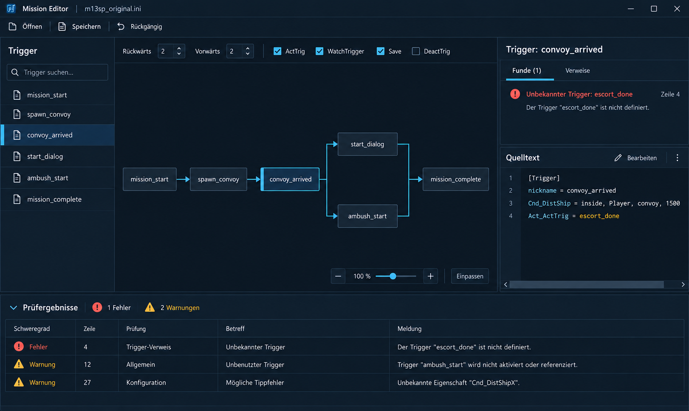

# Mission Editor: WPF-Layout Implementation Plan

> **For agentic workers:** REQUIRED SUB-SKILL: Use superpowers:executing-plans to implement this plan task-by-task. Steps use checkbox (`- [ ]`) syntax for tracking. Implementierung noch nicht freigegeben; der Plan kann an einen anderen Agenten übergeben werden.

**Goal:** Den bestehenden Missionseditor im abgestimmten Stil von Variante 2 gestalten und seine Arbeitsbereiche besser nutzbar machen.

**Architecture:** Ein zentrales WPF-ResourceDictionary stellt Farben und Control-Styles bereit. Das vorhandene MainWindow und der in C# erzeugte Graph verwenden dieselben Ressourcen. Bestehende Commands, ViewModels und Dateiverarbeitung bleiben Grundlage.

**Tech Stack:** C#, .NET 10, WPF, XAML; bestehende xUnit-Tests. Keine neue UI-Bibliothek.

**Spec:** Der folgende Abschnitt „Abgestimmtes Design“ dokumentiert die im Chat gewählte Gestaltung und den Umfang. Zielrepository: D:\Dev\FreelancerMissionEditor. Dieser Plan liegt im Zielrepository unter docs/superpowers/plans/ und enthält den vereinbarten Umfang für die Übergabe an einen anderen Agenten.

## Referenzen für die Umsetzung

### Gewählte visuelle Referenz

[Mockup: Variante 2 – Modern Mission Control](assets/mission-editor-variante-2.png)



Diese Missionsansicht ist die visuelle Grundlage. Das spätere Kampagnenmockup gehört nicht zum aktuellen Umfang. Die Bildinhalte sind illustrative Beispieldaten; vorhandene Funktionen und die Vorgaben dieses Plans bestimmen das Verhalten. Abweichungen zugunsten der Lesbarkeit, korrekter Semantik und funktionierender WPF-Controls sind zulässig.

### Repräsentative Beispielmission

Vom Benutzer benannte lokale Datei: `D:\Freelancer Crossfire\_storychain_backup\M13\m13sp.ini`.

Die Datei ist mit Zustimmung des Benutzers bytegetreu als `tests/Fixtures/Missions/m13sp.ini` ins Repository kopiert und dient als portable Beispielmission für die Sichtprüfung. Die Originaldatei und die Repository-Fixture bleiben unverändert. Schreib-, Lösch- und Undo-Prüfungen nur an einer gesonderten temporären Kopie durchführen. Die Fixture wird nicht automatisch als neuer Unit-Test eingebunden. Fehlende Sonderfälle wie Duplikate nur bei Bedarf mit separaten temporären Daten ergänzen.

Start aus dem Repository:

```powershell
dotnet run --project src/MissionEditor.App -- 'tests/Fixtures/Missions/m13sp.ini'
```

## Abgestimmtes Design

- Variante 2 „Modern Mission Control“: dunkles Marineblau, ruhige Flächen, dünne Trennlinien, sparsame cyanfarbene Hervorhebungen. Keine dekorativen Raster, Leuchteffekte oder Metalltexturen.
- Nur der bestehende Missionseditor einschließlich Abschnittseditor wird überarbeitet. Keine Kampagnenverwaltung, StoryChain-Anbindung, Kapitelanlage oder Skriptaufteilung.
- Trigger links, Graph als Hauptarbeitsfläche in der Mitte, Details und Quelltext rechts, einklappbare Prüfergebnisse unten.
- Funde und Verweise teilen sich den oberen Detailbereich über Tabs; Quelltext bleibt darunter sichtbar.
- Bestehende Öffnen-/Speichern-, Filter-, Navigations-, Bearbeitungs- und Prüfabläufe bleiben verfügbar.
- Mockup-Daten, Beispielsymbole und Beispielwarnungen sind keine neuen Produktfunktionen. Bestehende Kantenführung bleibt erhalten.

## Global Constraints

- Benutzertexte Deutsch; Code-Kommentare Englisch mit XML-Dokumentation gemäß Repository-Konvention.
- .NET 10 und WPF beibehalten; keine neuen Pakete, Fonts oder Icon-Abhängigkeiten erforderlich.
- INI-Parser, Speicherung einschließlich .bak und Undo-Semantik nicht verändern.
- Keine persistenten Layout-Einstellungen, Theme-Umschaltung oder benutzerdefinierte Fenstertitelleiste in diesem Umfang.
- Systemdialoge zum Öffnen/Speichern und native MessageBoxen bleiben systemgesteuert; eigener Abschnittseditor wird gestaltet.
- UI-Schrift Segoe UI 14 DIP, sekundäre Informationen mindestens 12 DIP, Quelltext Consolas 13 DIP.
- Abstände in 4-DIP-Schritten; Standard-Controls mindestens 30 DIP hoch; sichtbare Tastatur-Fokusringe.

## Review Focus

1. 1280 × 800 bei 100 %: Werkzeugleisten dürfen nicht abgeschnitten werden; Graph und Quelltext müssen erreichbar bleiben.
2. 150 % / 200 % DPI bei gleicher logischer Arbeitsfläche: Text und Controls skalieren ohne Überlappung. Bei kleinerer verfügbarer Arbeitsfläche kontrolliertes Scrollen statt Abschneiden.
3. Lange Triggernamen und lange INI-Zeilen: Ellipsis mit vollständigem Tooltip beziehungsweise horizontales Scrollen.
4. Fehlerstatus bei ausgewählter, nicht fokussierter Zeile: Auswahl bleibt sichtbar, Fehlersymbol bleibt erkennbar.
5. Viele Funde und Duplikate: Virtualisierung, Sprung zum Fund und beide Definitionen bleiben nutzbar; Details verdrängen den Quelltext nicht.

## Dateien und Zuständigkeiten

Alle nachfolgenden Pfade relativ zu D:\Dev\FreelancerMissionEditor.

| Datei | Aufgabe |
|---|---|
| Neu: src/MissionEditor.App/Themes/MissionControl.xaml | Palette, Typografie, Control- und Zustandsstyles |
| src/MissionEditor.App/App.xaml | Dictionary global laden |
| src/MissionEditor.App/MainWindow.xaml | Arbeitsbereiche, Styles, responsive Werkzeuggruppen |
| src/MissionEditor.App/MainWindow.xaml.cs | Nur notwendige Anpassungen an Sichtbarkeit, Fokus und bestehenden Events |
| src/MissionEditor.App/Controls/TriggerGraphCanvas.cs | Ressourcen für gezeichnete Knoten und Kanten verwenden |
| src/MissionEditor.App/Controls/GraphOptions.cs | Legendenfarben mit Canvas abstimmen |
| src/MissionEditor.App/SectionEditorWindow.cs | Eigenen Dialog und Texteditor gestalten |
| Optional: src/MissionEditor.Core/Graph/GraphLayout.cs | Nur falls größere Schrift nicht in bisherige Knoten passt: vorhandene Größenoptionen beim Aufrufer verwenden; keine Änderung der Routinglogik |
| README.md | Bedienhinweise nur bei geänderten UI-Abläufen anpassen |

## Task 1: Ausgangszustand und Theme

**Interfaces:** Globales ResourceDictionary. Farbkeys: WindowBrush, SurfaceBrush, InputBrush, BorderBrush, TextBrush, MutedTextBrush, AccentBrush, SelectionBrush, HoverBrush, ErrorBrush, WarningBrush, InfoBrush, ActiveBrush, ActivateEdgeBrush, WatchEdgeBrush, SaveEdgeBrush, DeactivateEdgeBrush. Implizite Styles für Standard-Controls; explizite Styles für Panelüberschriften und gefährliche Aktionen.

- [ ] Aktuelle Repository-Anweisungen und git status prüfen; vorhandene Änderungen erhalten. Vor Implementierung Schreibzugriff auf Zielrepository herstellen und isolierten Branch nach Repository-Regeln verwenden.
- [ ] Ausgangszustand mit repräsentativer geladener Mission, ausgewähltem Fund und Abschnittseditor erfassen. Keine Missionsdatei zur Vorbereitung verändern.
- [ ] Baseline im Zielrepository ausführen: `dotnet build MissionEditor.slnx` und `dotnet test MissionEditor.slnx`. Bestehende Fehler dokumentieren.
- [ ] MissionControl.xaml anlegen und App.xaml einbinden. Palette: Window #0B111B, Surface #131E2C, Input #1B2A3B, Border #30465B, Text #E4EDF5, Muted #A6B8C9, Accent #63CFFF; Selection #173C56, Hover #1B3044, Error #F07878, Warning #E8B45E, Info #A6B8C9, Active #81C99B. Kanten: Activate #81C99B, Watch #63CFFF, Save #E8B45E, Deactivate #A6B8C9.
- [ ] Styles für Window, Button, TextBox, ComboBox einschließlich Popup, CheckBox, TabControl, ListBox/ListView, DataGrid einschließlich Header und Auswahl, Expander, Slider, ScrollBar, ToolTip und GridSplitter erstellen. Default-, Hover-, Pressed-, Disabled-, Selected- und Keyboard-Focus-Zustände berücksichtigen. Lokale Styles BasedOn setzen, damit implizite Styles nicht verloren gehen.
- [ ] Build und Start prüfen. Dropdown, Scrollbar und Tooltip öffnen; keine versehentlich hellen Teilflächen. Textkontrast messen: normale Texte mindestens 4,5:1, wesentliche Zustandsmarkierungen mindestens 3:1. Disabled separat beurteilen.

## Task 2: Hauptfenster und Werkzeugleisten

**Interfaces:** Vorhandene Commands und x:Name-Felder für Code-behind erhalten. Benannte Styles aus Task 1 verwenden. Keine neuen Datenmodelle.

- [ ] Toolbar in Dateiaktionen, Bearbeitung und Navigation gliedern. Alle bisherigen Befehle einschließlich Speichern unter und Neu laden erreichbar halten; seltene Aktionen dürfen ins Überlaufmenü.
- [ ] Startbreiten links 280 DIP, rechts 400 DIP, Graph restlich; minimale Seitenbreiten 220/320 DIP, Graph mindestens 360 DIP. Splitter 6 DIP. MinWidth 1120 DIP und MinHeight 700 DIP für Fenster vorsehen.
- [ ] Triggerüberschrift und dauerhaft sichtbares Label „Trigger suchen“ ergänzen. Bestehenden Nur-Funde-Filter, Recycling-Virtualisierung und inaktive Auswahl erhalten.
- [ ] Graphoptionen in umbrechende Gruppen Tiefe und Kantentypen aufteilen. Zoom nur einmal in einer eigenen unteren Graphleiste mit Einpassen und 100 % anbieten. Vorhandenen ZoomSlider und Handler behalten; Überlagerung mit Graphscrollbars vermeiden.
- [ ] Verständlichen Leerzustand mit bestehendem Öffnen-Command und Drag-and-drop-Hinweis ergänzen; vorhandene Zustandsbindung verwenden oder rein abgeleitete VM-Property ergänzen, falls erforderlich.
- [ ] Bei 1280 × 800 und schmalen Splitterpositionen alle Gruppen, Filter, Tooltips und Tastaturbefehle prüfen. Lange Namen dürfen keine Nachbarspalte überdecken.

## Task 3: Details, Quelltext und Prüfergebnisse

**Interfaces:** Existing Bindings References, SelectedFindings, SelectedSectionLines, FindingsView und MinimumSeverity weiterverwenden. OnReferenceClicked, OnEditSection, OnDeleteSection und Fundnavigation erhalten.

- [ ] Rechts Titel/Summary, oberen Tab-Bereich „Funde“ / „Verweise“, Splitter und unteren Quelltextbereich anordnen. Bestehendes FindingsExpanded-Verhalten und Fundnavigation auf Tabs abbilden: Sprung zu Fund öffnet nötigen Tab. Beim fehlenden Fund bleibt Verweise nutzbar.
- [ ] Quelltextzeilen standardmäßig ohne Umbruch und mit horizontaler Scrollbar darstellen. Zeilennummern, Fundsymbole, Mehrfachauswahl und Strg+C erhalten. Abschnittsaktionen in ihrer jeweiligen Abschnittskopfzeile erhalten, insbesondere bei Duplikaten.
- [ ] Prüfergebnisse in einklappbaren Bereich überführen; vorhandene Höhe beim Wiederöffnen wiederherstellen, ohne sie dauerhaft zu speichern. Bestehenden Schwerefilter und Doppelklick beibehalten. Eine Fundnavigation aus der Triggerliste öffnet den Bereich, wenn erforderlich.
- [ ] Tabellenzeilen und Fundboxen auf dunkle Statusfarben umstellen. Statussymbol darf bei Auswahl nicht verschwinden; Auswahl zusätzlich mit Rand markieren. Lange Bedienerklärung als kurzen Hinweis oder Tooltip zeigen.
- [ ] Viele Funde, Fehler plus Auswahl ohne Tastaturfokus, lange INI-Zeile, Duplikate und leere Referenzliste visuell prüfen. Sprung auf korrekte Quelltextzeile und Kopieren einschließlich langer Zeilen kontrollieren.

## Task 4: Graph und Abschnittseditor

**Interfaces:** TriggerGraphCanvas.Layout, NodeClicked und Redrawn beibehalten. BrushOf(TriggerReferenceKind) liefert die zentrale Kantenpalette; GraphOptions-Legende verwendet dieselbe Quelle. SectionEditorWindow(string title, string text, string note) und Text behalten ihren Vertrag.

- [ ] Hart codierte helle Brushes im Canvas durch Ressourcen ersetzen. Auswahl cyan, fehlender Trigger mit rotem Rand und Fragezeichen, initial aktiver Trigger zusätzlich durch einen lesbaren Statusmarker. Vollständiger Name im Tooltip.
- [ ] Schrift vergrößern; anhand der vorhandenen GraphLayoutOptions ausreichend Knotenfläche vorsehen, falls nötig. Knoteninhalt, versteckte-Verweise-Zähler und Tooltip dürfen sich nicht überdecken. Keine Routing- oder Semantikänderung.
- [ ] Aktivieren durchgezogen, Watch gestrichelt, Save punktiert und Deaktivieren Strich-Punkt darstellen; entsprechende Muster an der Legende zeigen. Bestehende Hover-Hervorhebung, Selbstschleifen und Rückkanten erhalten.
- [ ] SectionEditorWindow mit globalen Ressourcen, 16 DIP Außenabstand, klarer Hinweisfläche und fester unterer Aktionszeile gestalten. Mindestens 600 × 400 DIP; Texteditor nimmt Restfläche ein. „Übernehmen“ mit sichtbarem Shortcut Strg+Enter, „Abbrechen“ weiterhin Esc; normales Enter bleibt Texteingabe.
- [ ] Graphnavigation, Pan, Zoom unter Maus, Einpassen, Knotenhover und alle Kantentypen visuell prüfen. Langen Abschnitt bearbeiten und abbrechen: keine Änderung; separaten temporären Testdatensatz übernehmen und Undo prüfen.

## Task 5: Gesamtabnahme

- [ ] `dotnet build MissionEditor.slnx` erfolgreich ausführen.
- [ ] `dotnet test MissionEditor.slnx` erfolgreich ausführen. Keine Tests ergänzen, die nur XAML-Farbwerte oder Layoutstruktur spiegeln. Falls beim Umbau neue Zustandslogik nötig wird, deren fachliche Übergänge gezielt testen.
- [ ] Sichtprüfung bei 1280 × 800 und 1920 × 1080 logischen Größen sowie 100/150/200 % DPI durchführen; verfügbare Testumgebung und nicht geprüfte Varianten ausdrücklich dokumentieren. DPI-Einstellungen des Benutzers nicht ungefragt ändern.
- [ ] Vollständiger Tastaturablauf: Öffnen, Strg+F, Trigger wählen, Fund öffnen, Verweis folgen, Abschnitt bearbeiten, abbrechen/übernehmen, Undo und Speichern auf temporärer Kopie. Kein veränderter Originaldatensatz.
- [ ] Screenshots von geladener Mission, komplexem Graph, Fund/Quelltext, geöffnetem Dropdown und Abschnittseditor gegen Variante 2 vergleichen. Lesbarkeit und Funktionsumfang haben Vorrang vor Bitmap-Pixeltreue.
- [ ] Diff auf versehentliche Parser-/Speicheränderungen, verlorene Commands und verbliebene helle Farben prüfen. Build-, Test- und visuelle Ergebnisse mit Einschränkungen berichten; keine pauschale Accessibility-Konformität behaupten.

## Reihenfolge und Freigabe

Task 1 → 2 → 3 → 4 → 5. Erst nach Prüfung dieses Plans implementieren. Empfohlen: Umsetzung durch denselben Agenten in dieser Sitzung, da XAML, Code-behind und gezeichneter Graph eng zusammenhängen. Kampagnenmockup bleibt Zukunftsreferenz und wird nicht implementiert.
